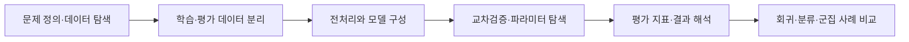

# KAMP Study
### 회귀·분류·군집화와 모델 평가를 연결한 머신러닝 스터디

**모델의 학습 원리부터 전처리, 교차검증, 클래스 불균형, 하이퍼파라미터 탐색까지 정리한 학습 포트폴리오입니다.**

[English](README.en.md) · [학습 지도](docs/LEARNING_MAP.md) · [모델 평가](docs/MODEL_EVALUATION.md) · [응용 실습](docs/CASE_STUDIES.md) · [자료 출처](THIRD_PARTY_NOTICES.md)

`Python` · `NumPy` · `pandas` · `scikit-learn` · `Matplotlib` · `Jupyter`

## Overview

KAMP 머신러닝 수강 자료를 바탕으로 지도학습과 비지도학습을 공부하고, 모델을 비교할 때 필요한 데이터 처리와 평가 방법을 정리했습니다. 회귀·분류·군집화의 차이를 이해한 뒤, 교차검증과 파라미터 탐색으로 이어지는 학습 흐름을 담았습니다.

공개 노트북 6개는 **『으뜸 데이터 분석과 머신러닝』 개정판의 수강용 예제**이며 원저자·출판사 표기를 유지했습니다. 추가 실습의 학습 주제는 문서로 정리했습니다.

## Study Highlights

| 학습 영역 | 다룬 내용 | 정리한 관점 |
|---|---|---|
| 회귀 | 선형·다변량·다항 회귀 | 입력 특징과 예측값의 관계, 모델 복잡도 |
| 분류 | 로지스틱 회귀, SVM, 결정 트리 | 분류 점수, 결정 경계, 특징 스케일 |
| 앙상블 | 배깅, Random Forest, 부스팅 | 여러 모델의 결합 방식과 특성 중요도 |
| 군집화 | K-means, DBSCAN, 관련 군집 모델 | 거리·밀도 기준과 군집 구조 |
| 차원 축소 | PCA | 특징 공간의 요약과 시각화 |
| 모델 선택 | Pipeline, 교차검증, GridSearchCV | 전처리와 탐색을 일관된 평가 흐름으로 구성 |
| 불균형 데이터 | 오버샘플링, SMOTE 계열, ROC | 정확도와 함께 Precision·Recall·F1·AUC 해석 |

## Learning Workflow



## Notebook Guide

| 노트북 | 주요 주제 |
|---|---|
| [07 · Linear Regression](notebooks/07_linear_regression.ipynb) | scikit-learn 기초와 선형 회귀 |
| [08 · Regression Models](notebooks/08_regression_models.ipynb) | 회귀 실습, 특징 처리와 모델 비교 |
| [09 · Classification & Clustering](notebooks/09_classification_clustering.ipynb) | 로지스틱 회귀, 분류와 K-means |
| [10 · SVM, Trees & PCA](notebooks/10_svm_trees_pca.ipynb) | SVM, 결정 트리, 앙상블, 차원 축소 |
| [11 · Model Selection](notebooks/11_model_selection.ipynb) | 교차검증, 하이퍼파라미터 탐색, 평가 |
| [12 · Perceptron](notebooks/12_perceptron.ipynb) | 퍼셉트론, 논리 연산, 다층 신경망 기초 |

노트북의 실행 출력은 제거했으며, 원본의 학습 코드와 설명·출처를 보존했습니다. 수강 자료의 예제를 학습 자료로 공개하는 저장소입니다.

## Applied Study Topics

- **와인 분류:** 와인 종류와 품질 예측 문제, 여러 분류기와 데이터 분포 비교.
- **정기예금 예측:** 고객 특징의 전처리와 불균형 이진 분류 평가.
- **고객 군집화:** K-means·DBSCAN 등 군집화 방식과 특징 구성 비교.
- **오버샘플링:** 소수 클래스의 표본 구성과 분류 지표 변화 해석.

[응용 실습 정리 →](docs/CASE_STUDIES.md)

## Getting Started

```bash
python -m venv .venv
python -m pip install -r requirements.txt
python -m jupyter lab
```

가상환경을 활성화한 뒤 설치 명령을 실행하고, 노트북을 순서대로 열어 학습할 수 있습니다. 개별 셀에서 별도 데이터나 추가 패키지를 사용하는 경우 해당 노트북의 안내를 확인합니다. 제공된 패키지 목록은 학습 환경 구성을 위한 목록이며 버전을 고정한 실행 환경은 아닙니다.

## Repository Layout

```text
KAMP-Study/
├── notebooks/                 # 출처 표기를 유지한 수강용 예제 6개
├── docs/
│   ├── LEARNING_MAP.md        # 학습 주제와 자료 연결
│   ├── MODEL_EVALUATION.md    # 전처리·교차검증·평가 정리
│   └── CASE_STUDIES.md        # 와인·예금·군집화 실습 주제
├── requirements.txt
└── THIRD_PARTY_NOTICES.md     # 교재·저자·배포 조건
```
